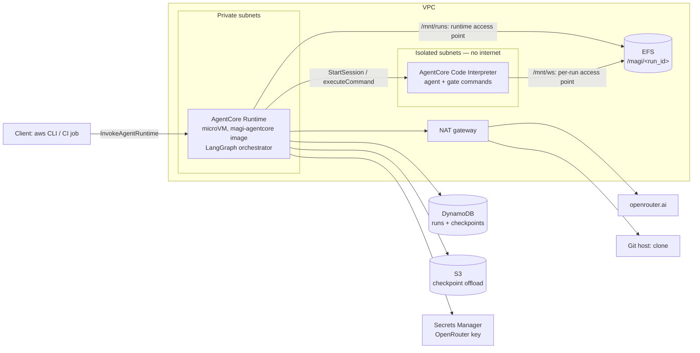

# Hosting on Amazon Bedrock AgentCore (managed services only)

[Overview](README.md) · [API](api.md) · [Configuration](configuration.md) · [Security](security.md) · [Limits & costs](limits-and-costs.md) · [Deploy](deploy.md) · [Testing](testing.md)

magi-system can run as a hosted service on AWS using **managed services only, without EC2**.
AgentCore only hosts the process; **models are always called through OpenRouter, never
Amazon Bedrock models**. The deployment enforces this: the entrypoint rejects any other
provider, and no IAM role can invoke Bedrock models.

> **Status: implemented and tested offline, not deployed.** No AWS resource has been created
> and no run has executed on AWS. The [spike checklist](testing.md#spike-checklist-before-the-first-real-run)
> lists what must be proven on AWS before a real run.

## Why

On a laptop or a CI runner, runs fail for host reasons: the machine sleeps, a long job is
interrupted, someone edits the control repository during a run. Hosted runs get:

- an isolated microVM per run;
- state that survives the process (DynamoDB + EFS);
- no laptop involved;
- several runs in parallel.

The engine, the MAGI decision, the gates and the policy are unchanged. Only three things
are added:

- a store backend;
- an execution runner;
- an entrypoint.

## Architecture

| Need | Managed service |
|---|---|
| Orchestrator (LangGraph, `RunService`) | AgentCore Runtime, **microVM** compute type (serverless, arm64, 2 vCPU / 8 GB, sessions up to 8 h) |
| Sandbox for agent and gate commands (replaces podman) | AgentCore **Code Interpreter**, custom resource, VPC mode, isolated subnets |
| Run workspaces and artifacts | **EFS** (encrypted). The runtime mounts `/magi`; each run's sandbox mounts only `/magi/<run_id>/workspace`. |
| Checkpoints, run records, effect dedup | **DynamoDB** (`langgraph-checkpoint-aws` `DynamoDBSaver` + one runs table), with **S3** offload for large checkpoints |
| OpenRouter API key | **Secrets Manager** |
| Image | **ECR** (immutable tags, scan on push) |
| Egress to OpenRouter and the Git host | **NAT gateway**, plus gateway endpoints for DynamoDB and S3 |
| Logs | CloudWatch (redacted events on stdout) and AgentCore Observability |

The AgentCore "Instances" compute type (EC2 in your account) is deliberately not used.

## Pages

| Page | Content |
|---|---|
| [api.md](api.md) | Request flow, actions (`start`, `resume`, `status`, `report`), sessions, resume |
| [configuration.md](configuration.md) | Environment variables, install, entrypoint |
| [security.md](security.md) | Sandbox isolation, profile/provider allowlists, secrets |
| [limits-and-costs.md](limits-and-costs.md) | Known limits, CodeBuild fallback, cost drivers |
| [deploy.md](deploy.md) | Deploy runbook (not executed yet) |
| [testing.md](testing.md) | Offline verification and the AWS spike checklist |

Code and infrastructure: `src/magi_system/interfaces/agentcore.py` (entrypoint),
`src/magi_system/execution/runner.py` (`CodeInterpreterRunner`), `src/magi_system/service/store.py`
(`DynamoRunStore`), `deploy/agentcore/` (Dockerfile, smoke test, Terraform).
