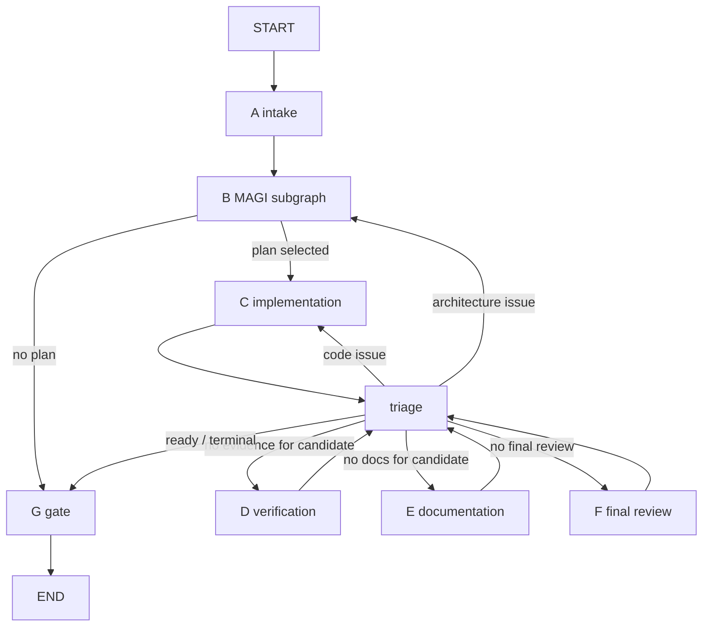

# Architecture

## Three entities

| Entity | What | Who writes it |
|---|---|---|
| **Control repository** | This repo: graph, agents, prompts, policy, gates, CLI. | Platform developers only. Agents never. |
| **Target repository** | The project a run changes. | Nobody during a run: it is only cloned. |
| **Run workspace** | `<runs-root>/<run-id>/workspace`, a clone of the target at one commit. | Agents, through role-scoped tools. |

`WorkspaceManager` refuses a `runs_root` inside the control repository or inside the target.

## Components

```
cli.py                 typer commands → RunService (no logic)
interfaces/agentcore.py AgentCore Runtime entrypoint → RunService (async start/resume, status, report)
service/app.py         RunService: start / resume / status / report; outcome; report files
service/store.py       run records, effect dedup, checkpoints: SQLite (default) or DynamoDB (MAGI_STORE)
engine/graph.py        main StateGraph + subgraphs A–G
engine/nodes_*.py      node functions (A intake, B magi, C impl, D/E/F verify/docs/final, triage+G gate)
engine/state.py        JSON-native state + reducers
engine/context.py      RunContext (runtime deps, not checkpointed), @node wrapper, control fingerprint
engine/gates.py        mechanical checks bound to a commit
engine/helpers.py      draft→artifact conversion, fan-out/fan-in bookkeeping, prompt rendering
engine/schemas.py      structured outputs requested from agents ("drafts")
decision/              claim verifier (tools) + admissibility/ranking (pure functions)
agents/                roster (ids, display names, perspectives) and the LLM caller / tool loop
llm/                   ModelAdapter protocol, ScriptedModel (offline), Anthropic adapter
tools/toolbox.py       role-scoped tools; access enforced in code
workspace/             Git wrapper and WorkspaceManager
execution/runner.py    ExecutionRunner: ContainerRunner (default), CodeInterpreterRunner (AgentCore), LocalRunner (dev only)
policy/                platform policy YAML + PolicyEngine
config/project.py      .magi/config.yaml schema, discovery
prompts/templates/     versioned prompts
observability/         redaction, JSONL event log, optional Langfuse mirror
offline.py             demo target + scripted happy path for the fake model
```

CLI, service, engine and workspace are separate so that every interface reuses
`RunService` without duplicating orchestration: the CLI, the GitHub Action (CLI) and the
AgentCore entrypoint ([agentcore/](agentcore/README.md)).

## Graph



- **A intake**: restores the baseline, snapshots files (git blob ids), records manifests
  and the policy as evidence, records the control-plane fingerprint.
- **B MAGI**: `analysis` → `proposal` → `review`, each a `Send` fan-out with a fan-in
  that waits for every expected result (typed failures included). Then `magi_verify`
  (tools check every claim) and `magi_select` (code ranks). Bounded revision loops back
  with `architecture_round + 1`.
- **C implementation**: `dev_writer` → `dev_initial_checks` → `dev_pair_assess` →
  `dev_pair`, strictly sequential. `impl_technical` handles technical retries.
- **D verification**: project build/test/lint, QA acceptance commands, integrity and
  scope checks, then QA/SRE/Security reviews (fan-out) whose claims are verified.
- **E documentation**: Tech Writer edits doc scopes only, on the implemented candidate.
- **F final review**: three MAGI in a fresh context (request, requirements, plan, diff,
  evidence, docs — no design transcript).
- **triage** (code): picks the next stage for the current candidate commit and routes
  issues. **G gate** (code): computes the terminal status.

There is no LLM supervisor, no `interrupt`, and no node that waits for a human.

## Decision protocol (B)

1. Independent analyses (same snapshot and policy, read-only tools, no peer visibility).
   Explicit requirements must quote the request verbatim; derived ones must trace to
   request quotes and are never mandatory. Untraceable ones are rejected and logged.
2. Conflicts (opposite claims on the same target) are logged; tools settle them.
3. Every analysis claim is verified with tools on the baseline.
4. Three independent proposals (requirements and verified facts as input).
5. Masked cross-review: each MAGI scores the *other two* proposals (labels are hashed
   ids; authorship is hidden but this is not a guarantee of independence).
6. Preventive QA / SRE / Security / Tech Writer review; QA derives acceptance scenarios
   from the original request.
7. Claims in proposals and findings are verified with tools; findings settle to
   CONFIRMED / REFUTED / UNRESOLVED.
8. Admissibility (all must hold): every mandatory requirement covered; non-empty changes
   and verification plan; no protected / out-of-scope paths; no refuted or unresolved
   critical claim; no unresolved critical assumption; no CONFIRMED blocker.
9. Ranking: weighted mean of peer rubric scores (`policy.decision.rubric`), self-scores
   excluded. Scores within `tie_epsilon` use `tie_break` rules
   (`fewer_planned_changes`, `fewer_assumptions`, `magi_order`) then proposal id.
   If an unverified claim could change the winner, it is verified first.
10. No admissible proposal → bounded revision (`max_architecture_rounds`) or terminate.

Invariants: a vote never changes a fact or a finding status; unanimity does not skip
verification; objections without evidence are UNRESOLVED, never a veto; a CONFIRMED
blocker excludes a proposal whatever the votes; UNKNOWN is never PASS; inadmissible
proposals are never ranked (no compensation).

Claim kinds verified mechanically: `file_exists`, `symbol_exists` (`path::symbol` or
`*::symbol`), `text_present`, `package_version` (`name>=x.y` from `package.json` /
`pyproject.toml`), `policy_exists` (dotted policy key), `command_succeeds` (through the
runner). `operational_guarantee` and `business_assumption` are always UNVERIFIABLE.
