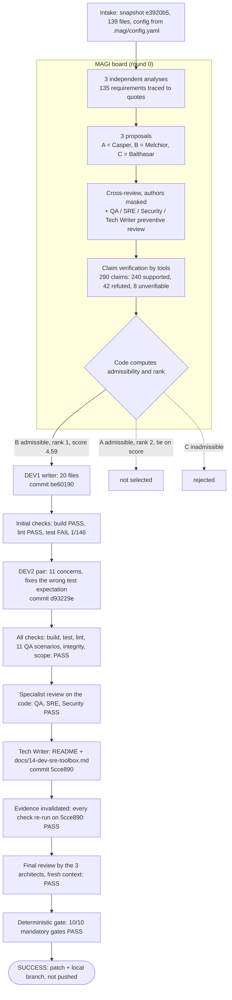
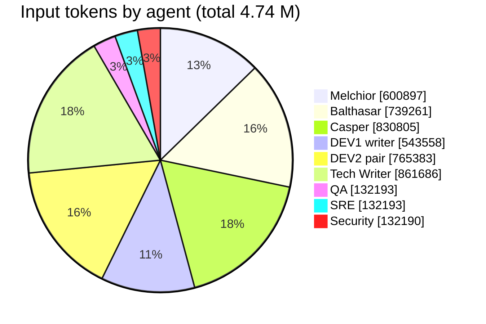
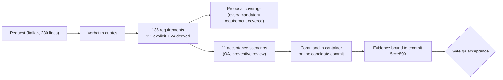
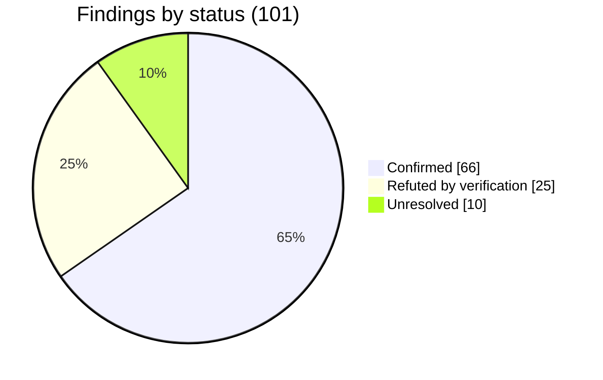

# Autonomous delivery of a "Dev/SRE Toolbox" by a multi-agent MAGI pipeline: a case study (run `run-20261015-205501-e0a70f`)

*magi-system case study · 2026-10-15 · target: `pytbak` (FastAPI) · model: DeepSeek v4.1 flash via OpenRouter*

## Abstract

We report a single end-to-end run of magi-system, an autonomous software-change platform in
which three independent "architect" agents (Melchior, Balthasar, Casper) analyze a change
request, propose plans, review each other's proposals with authors masked, and have every
factual claim checked against the repository by tools before code computes which plan is
admissible. Two developer agents (writer and pair) implement the selected plan, QA, SRE and
Security specialists verify it, a Tech Writer documents it, the three architects review the
final candidate in a fresh context, and a deterministic gate decides the outcome. Given a
long Italian change request asking for a three-tool "Dev/SRE Toolbox" in an existing FastAPI
service, the run ended with **SUCCESS** after 19 min 19 s and **US$ 1.05**: all ten mandatory
gates passed on the final commit, a 21-file change (+2,340 / −51 lines) with 67 new tests,
no regression in the 79 existing ones, and no push, merge or deployment. We describe how the
run unfolded, how each functional requirement was traced from the request to code and
evidence, and where the system's safeguards changed the course of the run.

## 1. Context

### 1.1 The platform

magi-system is a LangGraph application. The graph state is JSON-native and checkpointed in
SQLite, agents call an LLM through a provider adapter, and every command that touches the
target runs in a container with no network. Three properties matter for this case study:

1. **Facts are checked, not voted on.** Architects state claims in a typed form (file exists,
   symbol exists, text present, package version, policy key, command succeeds). A verifier
   checks them against the baseline commit. A plan that relies on a refuted critical claim,
   an unresolved critical unknown or a confirmed blocker is inadmissible, however well it
   scores.
2. **Evidence is bound to a commit.** Each check result carries the commit it ran on; the
   gate reads only the final candidate's results. Any new commit invalidates earlier evidence.
3. **No human in the loop, explicit failure.** Every loop has a budget, and every run ends
   in either a verified candidate or a typed failure state.

### 1.2 Setup of the run

| Item | Value |
|---|---|
| Target | `pytbak` 2.0.0 (FastAPI 0.143.1, Pydantic 2.14.1, Python ≥ 3.11), 139 tracked files, baseline `e3920b5` |
| Target config | `.magi/config.yaml`: build `python -m compileall -q app`, test `python -m pytest -q`, lint `ruff --select E9,F63,F7,F82` |
| Runner | Docker, image with the target's dependencies preinstalled, `--network=none` |
| Model | `deepseek/deepseek-v4.1-flash` for all nine agents, temperature 0, 32,000 output tokens per call |
| Routing | OpenRouter `provider: {sort: throughput, require_parameters: true}`, schema-constrained output |
| Budget | 3,000 tool calls, 600 LLM calls, 30 M tokens, US$ 5, 3,600 s |
| Request | 230 lines in Italian (English translation: [request.md](request.md)) |

The configuration is the result of eleven previous runs on the same target; the problems they
exposed and the fixes they triggered are documented separately in [training.md](training.md).

## 2. How the run unfolded

### 2.1 The pipeline as executed

### 2.2 Timeline

```mermaid
gantt
    title run-20261015-205501-e0a70f (wall clock, 15 Oct 2026)
    dateFormat HH:mm:ss
    axisFormat %H:%M
    section MAGI board
    Analysis (3 in parallel)          :a1, 20:55:01, 124s
    Proposals (3 in parallel)         :a2, 20:57:10, 97s
    Cross-review + preventive review  :a3, 20:58:47, 87s
    Claim verification + selection    :a4, 21:00:14, 11s
    section Implementation
    DEV1 writer                       :b1, 21:00:25, 178s
    Initial checks (container)        :b2, 21:03:23, 7s
    DEV2 pair (assess + fix)          :b3, 21:03:30, 166s
    section Verification
    Checks + QA scenarios             :c1, 21:06:16, 34s
    Specialist review                 :c2, 21:06:50, 13s
    Tech Writer                       :c3, 21:07:03, 116s
    Re-verification on docs commit    :c4, 21:09:00, 81s
    Final review (3 architects)       :c5, 21:10:21, 239s
    Gate                              :milestone, 21:14:20, 0s
```

The MAGI board, the phase that decides *what* to build, took 5 min 24 s (28 % of the run).
Implementation took 5 min 51 s; verification, documentation and the final review took the
remaining 8 min. The final review was the single longest step: one architect's output was
truncated by the 32,000-token cap twice (a temperature-0 repetition loop) and needed a
technical retry (§4.3).

### 2.3 Live log

The run was followed live through its event stream (`events.jsonl`). The commentary below is
the one given during the run, translated and lightly condensed. It is reproduced because it
shows what an operator sees and has to judge at each step.

> **20:55:01 · run_start** — Run 12 started: commit `e3920b5`, environment
> `container:docker:…pytbak-magi:local`, policy `default`. The three architects start their
> analysis in parallel, each with read-only tools and without seeing the others' work.

> **20:57:05 · analysis collected** — 135 requirements accepted (111 explicit, 24 derived),
> every explicit one carrying a verbatim **Italian** quote of the request. 5 rejected: 3
> paraphrased quotes not found in the request, 2 derived "requirements" with no traceable
> source (for example "protect the endpoints with Basic Auth": an architect's interpretation,
> correctly kept out of the requirements).

> **21:00:25 · selection** — Plan selected in round 0: **Proposal B, Melchior**. Balthasar's
> was inadmissible: a critical claim was refuted ("the platform policy lists
> `.github/workflows/**` … as protected paths") and a critical unknown about write scopes was
> unresolved. Note for later: that claim is *true*, but it was written as a `policy_exists`
> claim on a path, which the verifier looks up as a policy key (see §4.2). It did not block
> the run, since a plan was selected anyway.

> **21:03:23 · handoff dev.writer** — DEV1 wrote the code in 3 min, 4 escalations. Melchior's
> structure follows the repo's own convention: models in `app/models/toolbox.py`.

> **21:03:29 · check project.test FAIL** on `be60190`. Checked on a copy: 145 passed, 1 failed
> (`test_empty_documents_are_skipped`), the same test that failed in run 9 with a different
> plan and author: a recurring trap with empty YAML documents.

> **21:06:16 · handoff dev.pair** — DEV2 changed the **test**, not the code. That could be a
> legitimate correction or a weakened test, so the diff was checked: only the expected value
> changes (`documents == 3` → `== 2`), with a comment explaining PyYAML's behavior, and the
> actual assertion (`resources_inspected == 1`) stays. Verified independently: PyYAML returns
> 2 documents (`[None, dict]`) for `---\n---\n<doc>`. DEV2 was right, DEV1's expectation was
> wrong, and the code was correct.

> **21:07:03 · specialists on `d93229e`** — `qa.acceptance` PASS (11 scenarios),
> `sre.review` PASS (5 non-blocking findings), `security.review` PASS (0 findings).

> **21:09:04 · check on `5cce890`** — The Tech Writer has finished, producing a new commit
> `5cce890`. All checks are rerunning on it, and tests are already ✅. Next come the
> specialists and then the final review.

> **21:10:21 · specialists on `5cce890`** — The specialists pass again on the final
> candidate: QA ✅ 11 scenarios; SRE ✅ 5 non-blocking findings; Security ✅ 8 non-blocking
> findings. Next is the final review by the three architects, then the gate.

> **21:12:56 · agent_failure magi.balthasar** — Balthasar's final review was truncated twice
> at 32k, as in run 10 (a repetition loop). A technical retry is running for Balthasar only;
> Melchior's and Casper's reviews are kept.

> **21:14:20 · magi.final_review PASS** — Three final reviews completed, 7 findings, none
> confirmed blocking. **run_end: SUCCESS**, `change_level: verified`, final commit `5cce890`.

### 2.4 Effort by agent

| Agent | LLM calls | Input tokens | Output tokens | Tool calls |
|---|---:|---:|---:|---:|
| Melchior | 17 | 600,897 | 106,201 | 79 |
| Balthasar | 20 | 739,261 | 137,386 | 90 |
| Casper | 21 | 830,805 | 79,983 | 94 |
| DEV1 writer | 12 | 543,558 | 62,295 | 61 |
| DEV2 pair | 13 | 765,383 | 43,752 | 38 |
| Tech Writer | 13 | 861,686 | 44,376 | 31 |
| QA / SRE / Security | 3 each | 132,193 each | 41,871 / 18,028 / 17,843 | 0 |
| **Total** | **105** | **4,738,166** | **551,735** | **393** |

Input dominates (90 % of tokens) because each tool-loop turn resends the transcript. The three
architects account for 46 % of input tokens: the analysis, which is the part most exposed to
hallucination, is where the platform spends most.

## 3. Functional requirements: from request to evidence

### 3.1 Traceability

The request was decomposed into 135 requirements. An explicit requirement is accepted only if
its `source_quote` occurs verbatim (whitespace- and case-normalized) in the request; this is
what prevents an architect from inventing a requirement. QA then turned the requirements into
11 acceptance scenarios, each bound to a command run in the container on the candidate
commit.

### 3.2 Requirement-by-requirement outcome

| Functional requirement (request section) | Implementation in the final commit | Verified by |
|---|---|---|
| Modular feature inside the existing app, no new service, no rewrite | Package `app/toolbox/` + router `app/routers/toolbox.py`, mounted in `create_app()` behind `TOOLBOX_ENABLED` (default `true`); `app/main.py` +8 lines | Scenario "application compiles/starts without regressions"; regression tests; 79 pre-existing tests pass |
| Reuse conventions and dependencies | Prefix adapted to the repo: `/api/toolbox/...` (the repo has no `/api/v1`); settings in the existing Pydantic `Settings`; `loop.run_in_executor` pattern copied from `/api/fib/{x}`; PyYAML pinned in `requirements.txt` | Claims verified at analysis (`loop.run_in_executor` present in `app/routers/api.py`, `verify_credentials` in `app/auth.py`) |
| Common tool contract and explicit registry | `Tool` protocol (`name`, `version`, input model, `execute(params, limits) -> ToolResult`) in `app/toolbox/base.py`; `app/toolbox/registry.py` with a dict keyed by unique id, duplicate registration rejected, deterministic order | Catalog scenario; unit tests |
| `json.validate`: JSON text, parsed value or error with position, no URL/path | `app/toolbox/tools/json_validate.py`; invalid JSON is a negative outcome (HTTP 200, `outcome: fail`, error finding with line/column); URL-like strings are treated as plain text, never fetched | `tests/test_toolbox_json_validate.py`; smoke test: HTTP 200 + `outcome: fail` |
| `text.diff`: two strings, unified diff, bounded context lines | `app/toolbox/tools/text_diff.py` (`difflib.unified_diff`), fields `left`/`right`, context lines bounded by `TOOLBOX_MAX_DIFF_CONTEXT_LINES` | `tests/test_toolbox_text_diff.py`; smoke test: wrong field names → 422 with a structured error |
| `k8s.manifest.inspect`: multi-document, Deployment/StatefulSet/DaemonSet, static only | `app/toolbox/tools/k8s_manifest_inspect.py` (473 lines); YAML loaded with a `SafeLoader` subclass that also refuses aliases (no "billion laughs"); depth and document-count limits; unsupported kinds and non-mapping documents reported as findings | `tests/test_toolbox_k8s_manifest.py` (349 lines) |
| Report missing requests/limits, probes, `latest`/untagged images, privileged, `allowPrivilegeEscalation`, non-root | 18 finding codes, including `K8S_CONTAINER_MISSING_REQUESTS/LIMITS`, `K8S_MISSING_READINESS/LIVENESS_PROBE`, `K8S_IMAGE_TAG_LATEST`, `K8S_IMAGE_TAG_MISSING`, `K8S_PRIVILEGED_CONTAINER`, `K8S_RUN_AS_NON_ROOT_NOT_SET` | Smoke test on a bad Deployment: all 8 expected codes, 1 error + 7 warnings |
| Distinguish *missing* from *explicitly risky* | Separate codes: `K8S_ALLOW_PRIVILEGE_ESCALATION_NOT_DISABLED` (missing, warning) vs `K8S_ALLOW_PRIVILEGE_ESCALATION_ENABLED` (explicit `true`, error) | Unit tests; doc table |
| Init containers handled separately, no probe rules | Containers and `initContainers` walked separately (`is_init`); probe checks skipped for init containers | Unit tests "init containers" |
| `GET /tools`: id, description, version, input schema | `ToolListResponse`, input schema generated from each tool's Pydantic model | Catalog and OpenAPI scenarios |
| `POST /runs`: synchronous, HTTP 200 with result and `run_id`, no queue | `run_tool` awaits `run_in_executor(tool.execute)`; UUID `run_id` per call; no persistence, no `GET /runs/{id}` | API tests; smoke test |
| Uniform typed result; status vs outcome vs validation vs internal error kept distinct | `ToolRunResponse` (`run_id, tool, tool_version, status, outcome, summary, findings, output, duration_ms`); 422 for malformed requests and invalid tool input, 404 unknown tool, 413 over limit, 500 sanitized (`"Internal server error"`, no stack trace) | Scenario "uniform schema"; tests "malformed", "sanitized internal error" |
| Reuse auth; no public bypass | `APIRouter(..., dependencies=[Depends(verify_credentials)])` | Smoke test: 401 without credentials; auth tests |
| Configurable limits, controlled rejection, no silent truncation | `TOOLBOX_ENABLED` plus six `TOOLBOX_MAX_*` limits (request bytes, input bytes, YAML documents, YAML depth, findings, diff context lines); a finding-cap notice finding when findings are capped | Scenario "hostile or over-limit inputs"; final-review findings discuss the cap edge cases (§3.3) |
| Logs without payloads; reuse observability | `logger.info` with `run_id`, tool, status, duration only; no new observability stack | SRE review (5 non-blocking findings) |
| Tests: units per tool, API, Kubernetes cases, regression | 5 new test files, 67 new tests | `project.test`: 146 passed, 25 skipped |
| Documentation: feature, curl, responses, limits, how to add a tool, k8s limitations, ADR note | `docs/14-dev-sre-toolbox.md` (360 lines), README section, `docs/README.md` index, `CHANGELOG.md` | `docs.updated` gate; Tech Writer preventive review asked for Basic Auth in every curl example |

### 3.3 What the reviews found

The 101 findings raised during the run show where the specialists added value beyond the
tests. Before code was written, SRE raised the same three *major* concerns against all three
proposals: no per-run timeout or concurrency bound, `run_id` not propagated to tracing, and a
hard import-time dependency on PyYAML that would take the whole app down if missing. The Tech
Writer required every curl example to carry the Basic Auth header to be "working", as the
request demands. During implementation, DEV1 raised a *blocker* against its own work (the
failing test) and a *major* finding (README not updated after a failed edit command), both
handled downstream.

On the final candidate, 24 findings were raised and none was confirmed blocking. Examples:
`json.loads` recursion depth not visibly guarded; new `TOOLBOX_*` settings not added to
`.env.example`; an edge case where `max_findings=0` still returns one (notice) finding;
observability guarantees documented but not asserted by any executed check. Several
final-review findings were **refuted** by verification. For instance, Balthasar's "image
reference with an empty tag is not flagged" was disproved by the code. These are recorded in
the report as residual risks; they did not stop the run because the policy blocks only on
confirmed blockers.

## 4. Discussion

### 4.1 What the architecture changed in this run

- **Plan choice by facts.** Two proposals tied on the rubric score (4.59). The tie was
  broken by the deterministic rule in the policy, not by a vote. The third proposal was
  excluded before any code existed.
- **Pair review as a correctness check, not a formality.** The only failing test came from a
  wrong expectation in a test written by DEV1. DEV2 fixed the test with a justification that
  an operator could verify in one command, and no assertion was weakened.
- **Evidence invalidation.** The documentation commit changed only Markdown, yet every check
  was re-run on `5cce890`. The gate never accepts results from an earlier commit.
- **Fresh-context final review.** The three architects re-read the final change. In this run
  they found nothing blocking; in the previous run (run 10) the same step found a real bug
  that all 12 QA scenarios had missed (summary counts computed before findings truncation).

### 4.2 Threats to validity

- **One run, one target, one model.** The same request produced different plans in runs 9,
  10 and 12 (Balthasar's, Casper's and Melchior's). The result is an existence proof, not a
  success rate.
- **Self-consistency risk.** All nine agents used the same model, so common-mode errors are
  possible. Tool-based verification and container checks reduce, but do not remove, this risk.
- **Verifier coverage.** 42 claims were refuted. Most were real model errors, but at least one
  class is a verifier limitation: a claim that a path is protected, expressed as
  `policy_exists` on the path, is refuted although true. It contributed to one proposal's
  inadmissibility.
- **Lint scope.** The configured lint gate checks only syntax-level errors (`E9,F63,F7,F82`),
  because the target does not pass full ruff at baseline. Type checking is not configured in
  the target and was not run.
- **Operator judgment.** The test change by DEV2 was checked by a human observer during the
  run. The platform itself would have accepted it on the evidence alone.

### 4.3 Cost of robustness

Six model outputs were rejected because they hit the 32,000-token cap. The excerpts of
earlier runs show these are repetition loops at temperature 0 (e.g. "No X. No Y. No Z. …" for
~150,000 characters). The cap plus a retry with feedback recovered every case, at the price of
about four minutes of the final review and a share of the output tokens.

## 5. Conclusion

On a real FastAPI service and a demanding, 230-line change request, magi-system delivered a
verified change autonomously: requirements traced to the request, a plan selected by checked
facts, code written and corrected by two developer agents, eleven acceptance scenarios and
three specialist reviews passed, documentation updated, all evidence re-run on the final
commit, and a final review by three architects, for about one US dollar. The change was not
integrated: the patch and branch are artifacts for a human to review and merge.

## Appendix A. Artifacts

| File | Content |
|---|---|
| [request.md](request.md) | The change request, English translation |
| [artifacts/report.md](artifacts/report.md) | Run report (gates, decisions, findings, publication) |
| [artifacts/report.json](artifacts/report.json) | Same, machine-readable |
| [artifacts/candidate.patch](artifacts/candidate.patch) | Final verified change, `e3920b5..5cce890` |
| [artifacts/dev.writer_p1_c0.patch](artifacts/dev.writer_p1_c0.patch), [artifacts/dev.pair_p1_c0.patch](artifacts/dev.pair_p1_c0.patch) | Per-agent patches |
| [artifacts/events.jsonl](artifacts/events.jsonl) | Full redacted event stream (1,052 events) |
| [training.md](training.md) | The eleven runs before this one and the fixes they triggered |

Machine-specific paths in the artifacts were replaced by placeholders (`<target-repo>`,
`<runs-root>`, `<scratch>`).

## Appendix B. Mandatory gates on `5cce890`

| Gate | Verdict | Detail |
|---|---|---|
| project.build | PASS | `python -m compileall -q app`, exit 0 |
| project.test | PASS | `python -m pytest -q -p no:cacheprovider`, 146 passed, 25 skipped |
| project.lint | PASS | `ruff check --select E9,F63,F7,F82 app tests` |
| qa.acceptance | PASS | 11 scenarios, no confirmed blocker |
| security.review | PASS | 8 findings, none blocking |
| sre.review | PASS | 5 findings, none blocking |
| docs.updated | PASS | `README.md`, `docs/14-dev-sre-toolbox.md` |
| magi.final_review | PASS | 3 reviews, 7 findings, none blocking |
| integrity.protected_paths | PASS | no protected change |
| scope.write_scopes | PASS | all changes inside authorized scopes |
