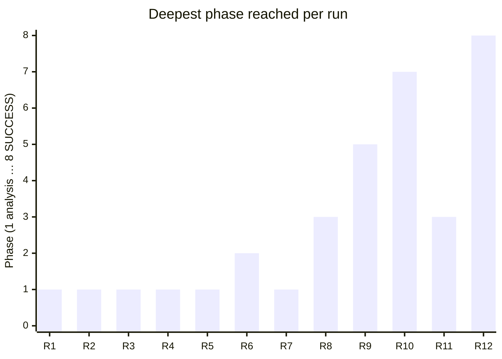
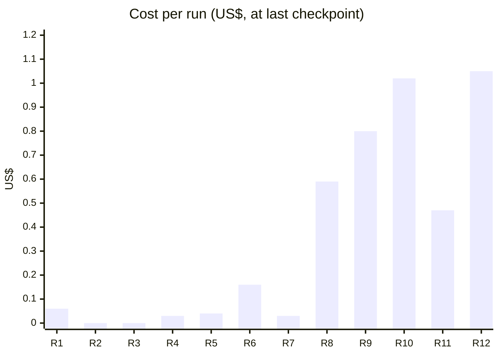
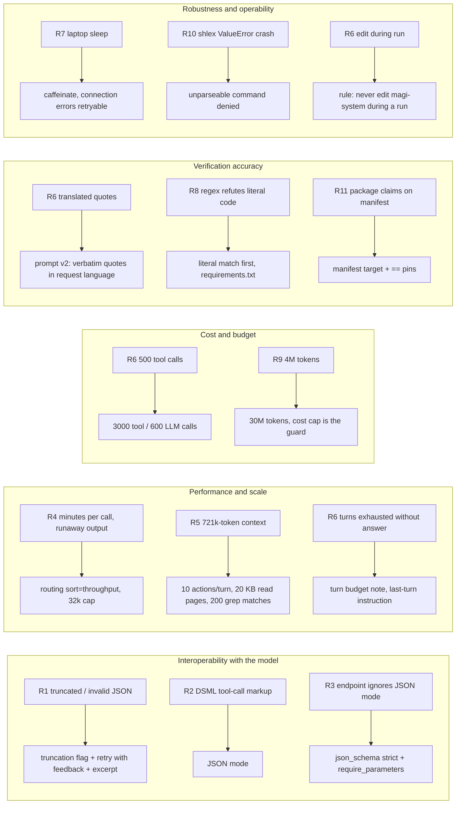
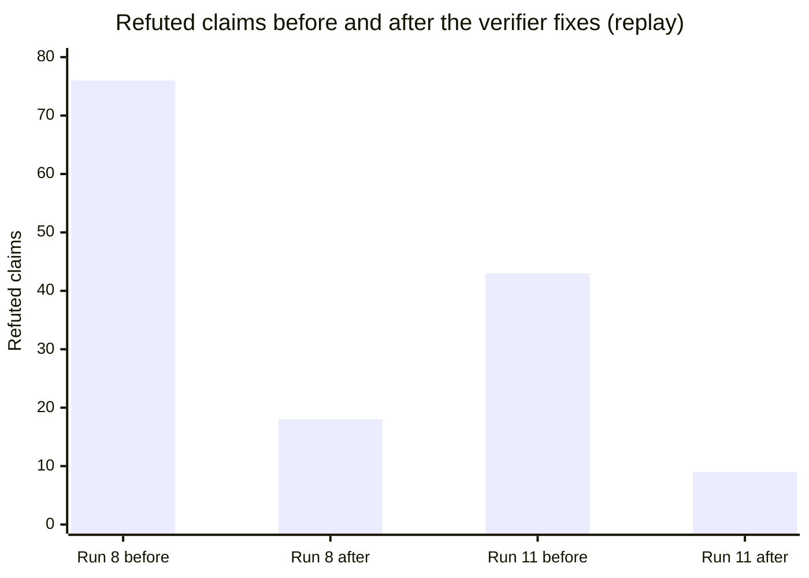

# From first real run to SUCCESS: twelve runs on pytbak and the non-functional requirements they exposed

*magi-system field report · 2026-10-15 · same target, same request, same model in every run*

Before 15 October 2026 magi-system had been exercised only by its offline test suite and a
scripted fake model. This report covers the first twelve real runs on a real target
(`pytbak`, a FastAPI service) with a real model (`deepseek/deepseek-v4.1-flash` via
OpenRouter), all with the request in [request.md](request.md). Runs 1–11 failed or were
stopped; run 12 succeeded and is described in [article.md](article.md).

None of the failures came from the change request's **functional** requirements: the
Toolbox was never the problem. Each one exposed a **non-functional** requirement of the
platform itself (interoperability with the model, latency, context size, cost, robustness,
verification accuracy, operability, integrity) that the offline suite could not exercise.
Every fix went into magi-system with tests and documentation before the next run.

## 1. Overview

### 1.1 How far each run got



Phase scale: 1 analysis · 2 proposals · 3 cross-review and selection · 4 implementation ·
5 checks and specialists · 6 documentation · 7 final review · 8 gate SUCCESS.

### 1.2 Cost and effort per run



| Run | Run id | Ended | Cost US$ | LLM calls | Deepest phase | Non-functional problem exposed |
|---|---|---|---:|---:|---|---|
| 1 | `run-20261015-181700-caaf4d` | stopped | 0.057 | 12 | analysis | Truncated and malformed model output; useless retries |
| 2 | `run-20261015-182545-d8cd84` | stopped | ≈0 | – | analysis | Model answers in its native tool-call markup instead of JSON |
| 3 | `run-20261015-182809-325f16` | stopped | ≈0 | – | analysis | JSON mode ignored by one OpenRouter endpoint |
| 4 | `run-20261015-183419-8e52e8` | stopped | ≥0.025 | ≥10 | analysis | Minutes-long calls (endpoint latency), runaway generations; runs directory deleted externally |
| 5 | `run-20261015-184726-8f77ae` | stopped | ≥0.038 | ≥15 | analysis | Context explosion: 269 actions in a turn, 721k input tokens |
| 6 | `run-20261015-185159-b080dd` | POLICY_DENIED | 0.162 | 60 | proposals | Tool-loop turn exhaustion; translated quotes; tool-call budget; edit during the run |
| 7 | `run-20261015-190205-1cbf27` | INFRA_FAILURE | 0.034 | 36 | analysis | Laptop sleep: timeouts stop, connections reset |
| 8 | `run-20261015-194904-6c86f4` | stopped | 0.594 | 65 | selection | Verifier refutes literal code quotes (regex metacharacters) |
| 9 | `run-20261015-195700-0efdc1` | BUDGET_EXHAUSTED | 0.798 | 88 | documentation | Token budget too small; temperature-0 repetition loops |
| 10 | `run-20261015-201806-1570b9` | INFRA_FAILURE | 1.024 | 126 | final review → fix | Uncaught exception on an unparseable agent command |
| 11 | `run-20261015-204713-5e4a56` | stopped | 0.466 | 50 | selection | Verifier misreads package claims on `requirements.txt` |
| 12 | `run-20261015-205501-e0a70f` | **SUCCESS** | 1.047 | 105 | gate | – |

Runs stopped by the operator recorded cost only up to their last checkpoint. Including the
probe experiments of §3 (≈ US$ 0.27), the twelve runs cost about **US$ 4.6** in total.

### 1.3 Problems and fixes at a glance



## 2. Before the first run: provider and environment

**Requirement: the platform must use the operator's LLM provider.** magi-system shipped with
only a direct Anthropic adapter. The operator's provider is OpenRouter, and direct Anthropic
use was ruled out. An `openrouter` adapter was added using only the standard library (HTTP
POST to `/chat/completions`, `usage: {include: true}` so cost is reported and the
`max_cost_usd` budget becomes enforceable), with mocked unit tests. It became the documented
default.

**Environment findings.** Without network access the container cannot install
dependencies, so a local image with the target's `requirements.txt` was built
(`docker.io/library/pytbak-magi:local`, matching the image allowlist prefix). The target had
no `.magi/config.yaml`: one was added in a scratch clone (the operator's repository was never
modified). The full ruff configuration fails on the target at baseline (50 errors, the
project uses black), so the lint gate was scoped to syntax-level errors. A first smoke call
returned `401 User not found`: the key file had one stray character from a paste. Format
checks on the key, never printing it, found the problem.

## 3. Runs 1–3: interoperability with the model's output format

### Run 1: truncation, trailing data and identical retries

Live, within three minutes: `agent_invalid_output … Extra data: line 1 column 24` for
Balthasar and Casper, then `Unterminated string … (char 26638)` for Casper and Melchior. The
token counts showed `output_tokens = 16000` exactly: the outputs were **cut at the cap**, but
the adapter did not read `finish_reason`, so truncation was reported as invalid JSON.
Worse, the retry resent the **identical** request at temperature 0 and got the identical
output (428 tokens, same error at char 23, twice).

**Non-functional requirements:** distinguishable failure modes (truncation vs. malformed
output); retries that can converge; diagnosability of rejected output.

**Fixes:** `ModelResponse.truncated` set from `finish_reason=length` (OpenRouter) and
`stop_reason=max_tokens` (Anthropic), raised as a distinct invalid-output reason while still
counting its tokens and cost; the retry appends the rejection reason to the request ("Your
previous response was rejected: … Be concise."); each `agent_invalid_output` event carries a
redacted excerpt of the output. The parser was kept strict on trailing data (if two objects
arrive, which one is meant is ambiguous); only its misleading docstring was fixed.

### Run 2: native tool-call markup

The new excerpt explained the "char 23" error at once:

```text
<｜DSML｜ calls>
<｜DSML｜ invoke name="read_file">
<｜DSML｜ parameter name="args" string="false">{"path": "app/main.py"}</｜DSML｜ parameter>
```

The model answered tool-loop turns in its **native tool-call markup**; the first `{` the
parser found was `{"path": "app/main.py"}`, exactly 23 characters. Feedback alone did not
help: the next attempt produced DSML again.

**Fix:** request JSON mode (`response_format: {type: json_object}`), validated with a real
call.

### Run 3: one endpoint ignores JSON mode

DSML came back. A debug harness recorded the real request bodies and raw responses of a
budget-capped run (4 LLM calls): every call was served by the endpoint "Relace", and the
**identical** request alternated between JSON and DSML. A format matrix on the captured
real requests then separated the two variables (90 calls, US$ 0.08):

| Endpoint | No format | `json_object` | `json_schema` strict | Latency |
|---|---|---|---|---|
| Relace (cheapest) | 5/6 valid | 3/6 | **2/6** (DSML) | medium |
| Together | 6/6 | 6/6 | 6/6 | 1–3 s |
| OpenInference | 6/6 | 6/6 | 6/6 | 17–47 s |
| Morph | 5/6 | 6/6 | 5/6 | variable |

The endpoint, not the format, decided validity. Relace accepts `response_format` but does
not declare `structured_outputs`.

**Fix:** schema-constrained output, `response_format: {type: json_schema, strict: true,
schema: <agent schema>}`, with `provider: {require_parameters: true}` so OpenRouter routes
only to endpoints that enforce it. Result on the captured request: 3/3 valid.

**Non-functional requirement:** output-format conformance must be **enforced by the
provider** where possible, not requested in the prompt.

## 4. Runs 4–5: latency, runaway output and context size

### Run 4: minutes per call

Casper completed the analysis cleanly, the first agent to do so. Melchior and Balthasar then
waited minutes on single calls, with the process idle and two HTTPS connections open. The
initial hypothesis (reasoning tokens) was tested and **rejected** by a second matrix
(reasoning effort × routing, 36 real calls, US$ 0.17):

Average latency per cell, over the three reasoning settings (default, `effort: low`,
`enabled: false`), two calls each:

| Turn (input) | Default routing | `sort: throughput` |
|---|---|---|
| 6k tokens | 1.6–2.6 s | 1.3–7.2 s |
| 15k tokens | 1.3–5.0 s | 0.9–12.5 s |
| 30k tokens | **61–97 s** (single calls up to 193 s) | **1.9–8.5 s** |

Reasoning tokens were at most about 1.7k per call; `effort: low` or `enabled: false` changed
little. Two calls degenerated into ~30k tokens of repetitive content. The operator had raised
the output cap first to 100k, then to 600k, after run 1; the data showed a large cap only lets
a runaway call run longer.

**Fixes:** per-agent `routing` (passed as OpenRouter's `provider`, with `require_parameters`
always forced) and `reasoning` settings; `routing: {sort: throughput}` and
`max_output_tokens: 32000` in the run settings.

**Incident:** during run 4 every run directory under `~/.magi/runs` was deleted by something
outside magi-system; no magi code path removes completed runs. Runs from run 5 on used a
separate `--runs-root` and the problem did not recur. The cause was not found.

### Run 5: context explosion

Fast calls and no invalid output, but Melchior issued **269 tool actions in one turn**, and
Balthasar's third call carried **721,591 input tokens**, close to the 1,048,576-token
context window. Every tool result went into the transcript and every turn resent it.

**Non-functional requirement:** bounded context growth per agent step.

**Fixes (minimal):** at most 10 actions per turn (`limits.max_agent_actions_per_turn` in the
platform policy; extra actions are answered with an explicit error, not dropped);
`read_file` returns 20 KB pages with an `offset` argument and a "file continues" marker;
`grep` returns at most 200 matches with a truncation marker (the previous 500 cap was silent
and not enforced across files).

## 5. Run 6: turn budget, language, budget and integrity

The three analyses completed for the first time (Melchior 53 s, Balthasar 79 s). Four problems
followed.

1. **Turn exhaustion.** Casper's second attempt used all 12 tool-loop turns reading files and
   never returned a final answer: with the new action cap it explored slower and did not know
   it was running out. **Fix:** each turn ends with `Turn i of N: k turn(s) left`; the last
   says `last turn. Return the final answer now, with no actions.`
2. **Translated quotes.** All 16 requirements of one architect were rejected: the request is
   Italian, the quotes were translated to English, and traceability requires verbatim quotes.
   **Fix:** analysis prompt v2: quotes are copied character for character in the request's
   language; the architect's own text may stay in English. In run 8, 121 requirements were
   accepted with Italian quotes.
3. **Tool-call budget.** `BUDGET_EXHAUSTED: tool_calls (limit 500)` during proposals: about
   400 calls went into analysing a 139-file repository. **Fix:** 3,000 tool calls and 600 LLM
   calls in the settings and the example.
4. **Integrity check.** The run ended `POLICY_DENIED: control plane changed during the run`.
   magi-system code had been edited while the run was active. The platform refused to certify
   anything, which is the intended behavior. **Operational rule:** never edit magi-system
   while a run is active.

A smaller defect was also fixed: a truncated output produced an empty excerpt. The excerpt
now keeps the first and last 300 characters, since the tail is what shows truncation and
loops.

## 6. Run 7: the laptop went to sleep

Casper finished in 1 min 41 s; Melchior and Balthasar then hung for 16 minutes and failed at
the same instant with `Connection reset by peer` (`INFRA_FAILURE`). An isolated test showed
the caller's 2-second timeout returning after **655 s**; the power log showed a 655-second
sleep at that time, and a sleep from 19:02:40 to 19:18:48 during the run. On macOS the
monotonic clock does not advance during sleep, so timeouts never fire, and open TCP
connections are reset on wake.

**Non-functional requirements:** the run must survive transient network loss; the operating
environment must be documented.

**Fixes:** connection errors (`OSError`, `http.client.HTTPException`) are mapped to a
retryable `provider_error` instead of an infrastructure crash; README and known limits
document `caffeinate -i` for laptop runs.

## 7. Runs 8 and 11: verification accuracy

### Run 8: literal code read as a regular expression

The first run through cross-review: 121 requirements, three proposals, seven reviewers. Then
no proposal was admissible. Among the refutations:

```text
pattern 'dependencies=\[Depends\(verify_credentials\)\]' found in app/routers/debug.py   → supported
pattern 'dependencies=[Depends(verify_credentials)]'   not found in app/routers/debug.py → refuted
```

Same text, opposite verdicts. `text_present` claims were matched only with `re.search`, so a
literal code quote containing `(`, `[` or `.` was refuted although the line exists (checked
for five claims with `grep -F`). A second gap: package checks ignored `requirements.txt`.

**Fixes:** literal substring match first, then regex; an invalid regex can only be meant
literally. `requirements.txt` added to the manifests. **Replay** of run 8's 338 real claims
with the new verifier, offline and free: refuted claims went from **76 to 18**, all 18
genuine model errors (e.g. build commands claimed to be in `pyproject.toml` while they live
in `.magi/config.yaml`).

### Run 11: package claims written against a manifest

All three proposals were inadmissible again, with about 40 refutations of the form
`requirements.txt not declared in any manifest`. The claims were
`package_version` with `target: requirements.txt` and `pattern: fastapi==0.143.1`, which is
true; the verifier read the target as a package name and supported only `>=`.

**Fixes:** with a manifest file as target, the pattern is the package spec; `==` pins and
extras (`uvicorn[standard]`) are supported. Replay of run 11's claims: **43 → 9** refuted,
all genuine. The run was stopped in round 1, since the revision would have been checked by
the same verifier.

**Non-functional requirement:** the verifier's false-refutation rate must be low, because a
false refutation silently turns a correct plan into an inadmissible one. Replaying recorded
claims against the baseline is now the standard way to test a verifier change before paying
for a run.



## 8. Runs 9–10: budget, loops and robustness

### Run 9: the token budget

The first run to write code. Balthasar's plan was selected (score 4.32); DEV1 wrote 20 files
with 130 of 131 tests passing; DEV2 fixed the failing test; 8 of 10 mandatory gates passed on
`ea193e7`, including 14 QA scenarios. The run then stopped `BUDGET_EXHAUSTED: tokens (limit
4000000)` inside the Tech Writer step, at US$ 0.80, far below the US$ 5 cost cap. 90 % of
tokens were input re-sent in tool loops.

The SRE review also showed the clearest **temperature-0 repetition loop** of the session,
truncated twice at 32k tokens, about 150,000 characters each:

```text
… The plan's obligation to confirm no-payload logging is not covered. The plan's obligation
to confirm auth backoff is not covered. The plan's obligation to confirm the kill switch …
… No blocker or major finding is raised. No critical assumption is recorded. No question is
asked. No merge, deployment or self-approval is requested. No prose outside the JSON …
```

**Fixes:** `max_tokens: 30000000` in the settings and the example; with OpenRouter the
measured cost cap is the real guard. The Tech Writer was rewriting whole files several times
(`docs/14-dev-sre-toolbox.md` four times, `README.md` twice); a "be concise" prompt change was
prepared and then dropped by the operator. Repetition loops were left to the 32k cap plus
retry: a frequency penalty could also damage JSON output and was not measured.

### Run 10: a real bug found, then a crash

Casper's plan; DEV1 green at the first try; all checks, specialists and the Tech Writer
passed; every check re-ran on the documentation commit. Then `magi.final_review` **failed**
with a confirmed finding: *"summary counts are computed before findings truncation and can
disagree with the returned findings list"*. None of the 12 QA scenarios had caught it. The
system routed it back to DEV1, who fixed it with a regression test, and all checks passed.
This is the platform working as designed; it is a functional bug in the generated code, not a
platform defect.

Then, in DEV2's pass on the fix, the process crashed: `ValueError: No closing quotation`.
DEV2 had issued a multi-line `python -c '…'` command with unbalanced quotes; `shlex.split`
raised and nothing caught it. The run was marked resumable, but resume refuses after a
magi-system change and, at temperature 0, would likely replay the same command.

**Fix:** an unparseable command is denied by the policy engine (`command cannot be parsed`)
and returned to the agent as an error.

**Non-functional requirement:** no agent action may crash the orchestrator; every agent
error must come back to the agent as data.

## 9. Run 12: SUCCESS

All ten mandatory gates passed on `5cce890` in 19 minutes for US$ 1.05. The run is analysed in
[article.md](article.md). It exercised none of the fixed failure modes except the 32k cap
plus retry (six truncated outputs, one technical retry in the final review).

## 10. Platform state after the twelve runs

| Area | Change | Where |
|---|---|---|
| Provider | OpenRouter adapter, schema-constrained output, `require_parameters`, routing and reasoning passthrough, truncation flag, connection errors retryable | `llm/providers.py`, `llm/base.py`, `models/run.py` |
| Agent caller | Retry with feedback, excerpt head+tail, actions-per-turn cap, turn budget note | `agents/caller.py`, `policy/platform_policy.yaml` |
| Tools | `read_file` pages with `offset`, `grep` cap with marker | `tools/toolbox.py` |
| Prompts | Analysis v2: verbatim quotes in the request language | `prompts/templates/magi_analysis.md` |
| Verifier | Literal-first text claims; `requirements.txt`; manifest-target package claims; `==` pins and extras | `decision/verifier.py` |
| Policy engine | Unparseable command denied, not raised | `policy/engine.py` |
| Settings | 32k output, 300 s timeout, 3,000 tool / 600 LLM calls, 30M tokens, US$ 5 | `examples/settings.example.yaml` |
| Operations | `caffeinate -i`, separate `--runs-root`, never edit magi-system during a run | README, `docs/limits.md` |

The offline suite grew from 186 to 208 tests, each fix with its own test, documented in
`docs/` in the same change.

### Open items

- A `policy_exists` claim on a path ("`.github/workflows/**` is protected") is refuted
  although true. It recurred in every run and made one proposal inadmissible in run 12.
- Temperature-0 repetition loops cost minutes and tokens; the cap and retry contain them.
- Reviewers see only the last 60,000 characters of the diff; in run 12 (~99k) the router,
  models and registry were cut off, as several reviewers noted. Found while writing the
  article on run 12.
- A correct final-review finding in run 12 (empty image tag `nginx:` not flagged) was refuted
  by verification; see [article.md](article.md) §5.5.
- The deletion of `~/.magi/runs` in run 4 remains unexplained.

## 11. Lessons

1. **An offline suite with a scripted model cannot reveal interoperability problems.** Every
   failure in runs 1–7 came from the boundary between the platform and a real model,
   provider or machine.
2. **Measure before fixing.** Two small probe matrices (about US$ 0.25) replaced two wrong
   hypotheses ("the format matters", "reasoning causes the latency") with the real causes
   (endpoint choice, routing).
3. **Replay recorded data.** Re-running real claims through a changed verifier, offline,
   proved each verifier fix before spending on a new run.
4. **Safeguards work only if they are not bypassed.** The integrity check (run 6) and the
   no-resume-after-change rule (run 10) both cost a run, and both were right.
5. **The decision layer is only as good as its verifier.** In runs 8 and 11 a correct plan
   was rejected by a false refutation. Verifier accuracy is a first-class requirement of a
   "facts, not votes" design.
