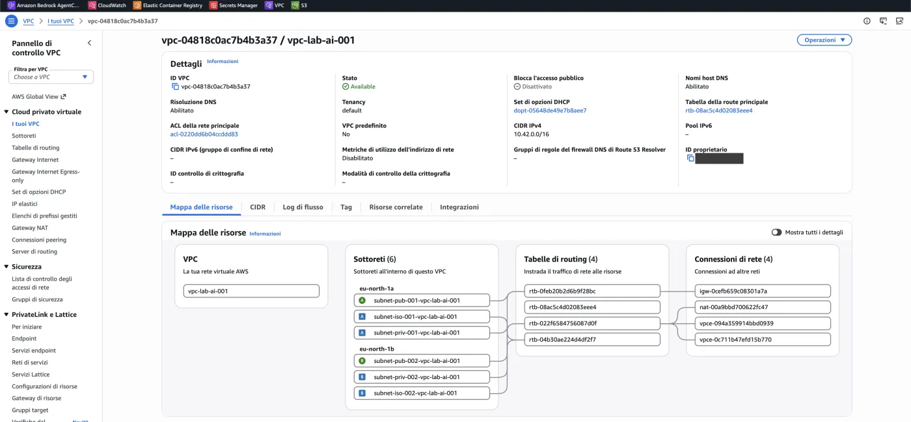
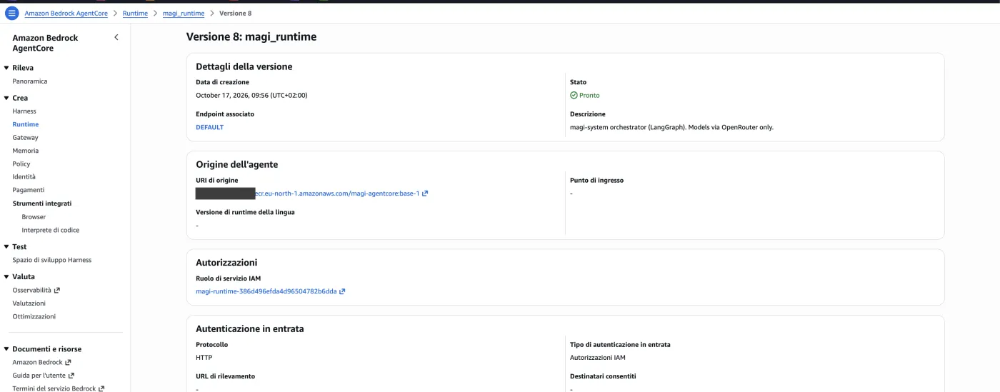
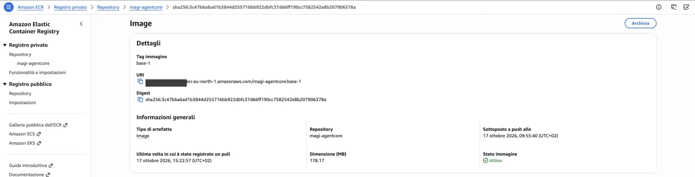
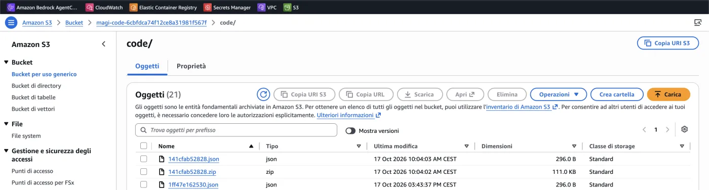
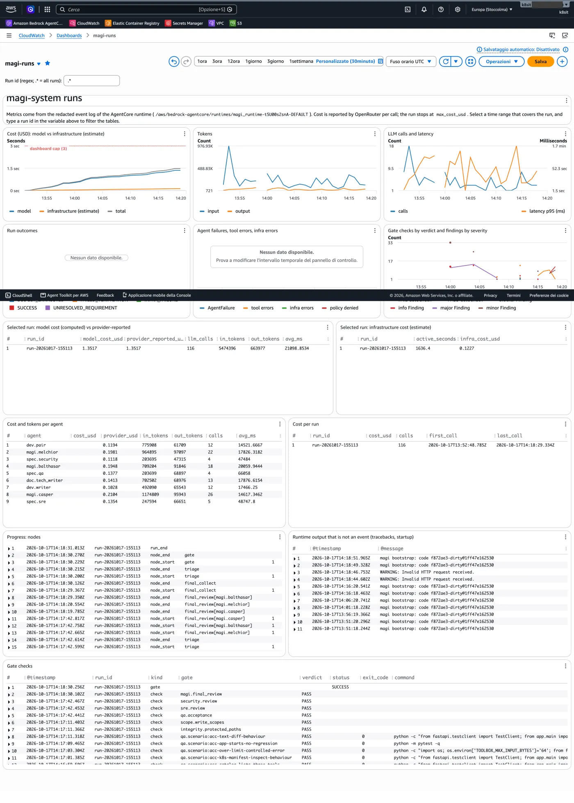
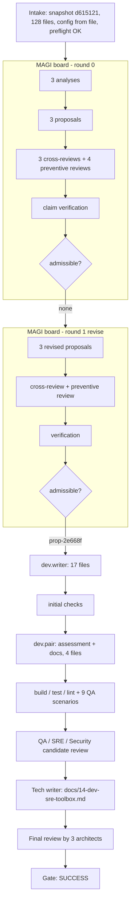
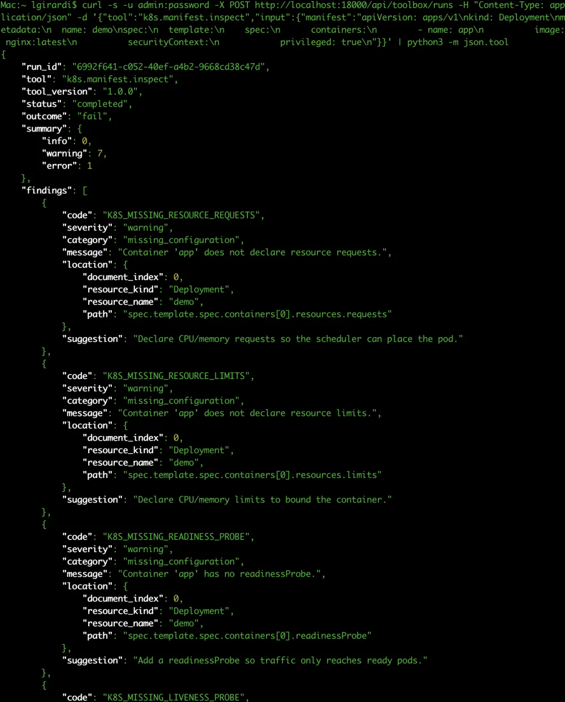

# A Dev/SRE Toolbox delivered by a multi-agent MAGI pipeline on Amazon Bedrock AgentCore: a case study (run `run-20261017-155113`)

*magi-system case study · 2026-10-17 · target: `fastapi-agentcore` (public FastAPI repository) · model: DeepSeek via OpenRouter · runtime: Amazon Bedrock AgentCore, eu-north-1*

## Abstract

This is the second end-to-end case study of magi-system and the first on **Amazon Bedrock AgentCore**. The change
request is the same as in the first study (`run-20261015-205501-e0a70f`, local container backend): add a three-tool
"Dev/SRE Toolbox" (`json.validate`, `text.diff`, `k8s.manifest.inspect`) inside an existing FastAPI service. Three
independent "architect" agents (Melchior, Balthasar, Casper) analysed the request, proposed plans and reviewed each
other with authors masked; every factual claim was checked against the repository by tools; two developer agents
implemented the selected plan; QA, SRE and Security verified it; a Tech Writer documented it; the three architects
reviewed the final candidate in a fresh context; a deterministic gate decided. The run ended **SUCCESS** after 25 min
44 s and **US$ 1.35** of model cost (plus about US$ 0.12 of infrastructure): all ten mandatory gates passed on the final
commit `067510f2ab57`, a 21-file change (+2,329 / −49 lines) with 54 additional passing tests (133 passed, 25 skipped, against
79 passed before) and no push, merge or deployment. The patch was then applied to a clean clone, built into a
Docker image and exercised over HTTP outside the platform. The run needed a second architecture round, because none
of the three round-0 proposals was admissible; we explain why, and we also report what the gates did **not** catch
(for example, the generated documentation has no code fences) and what had to be fixed in the platform before a
real target could succeed.

## 1. Context

### 1.1 The platform

magi-system is a LangGraph application: JSON-native graph state checkpointed to a store (DynamoDB on AgentCore),
agents calling an LLM through a provider adapter, and every command that touches the target executed in an isolated
environment. Four properties matter here.

1. **Facts are checked, not voted on.** Architects state claims in a typed form (file exists, symbol exists,
   text present, package version, policy key, command succeeds). A verifier executes each claim against the
   repository; a proposal with a refuted or unresolved *critical* claim is inadmissible, whatever its score.
2. **Verdicts come from execution.** A gate is PASS only if a command was executed and succeeded. A check that was not
   executed is UNKNOWN or ERROR, never PASS. SUCCESS needs every mandatory gate to PASS (or be a justified,
   policy-allowed N/A) on the final commit.
3. **Roles are separated.** Architects design and judge; developers write; QA, SRE and Security verify; the Tech
   Writer documents; no agent grades its own work.
4. **The platform never publishes.** The outcome is a verified patch. Push, merge and deploy are out of scope.

### 1.2 What AgentCore changes

On the first study the pipeline ran on a laptop with containers. Here one run is one AgentCore Runtime session:

| Concern | Local study | This study |
|---|---|---|
| Orchestrator | local process | one Runtime microVM per run (2 vCPU, 8 GB), kept alive with `/ping` = `HealthyBusy` |
| Workspace and artifacts | local disk | Amazon EFS, `/magi/<run_id>/…` |
| Run state and checkpoints | SQLite | DynamoDB (+ S3 for large checkpoints) |
| Target commands | container, no network | AgentCore Code Interpreter in VPC mode, no internet, per-run EFS access point mounted at `/mnt/ws` |
| Toolchain in the sandbox | image | wheels installed by the Runtime (which has NAT) into `<workspace>/.git/magi-toolchain` |
| Code deployment | `uv run` | image with the locked dependencies, code bundle in S3 loaded at session start |
| Observability | files | CloudWatch Logs → 15 metric filters → dashboard `magi-runs` (model cost vs infrastructure cost, filter by run id) |

Map of the services and of the calls made in each step of a run: see `docs/agentcore/` (and the diagram published
with this study).

### 1.3 Setup of the run

| Item | Value |
|---|---|
| Target | `https://github.com/lorenzogirardi/fastapi-agentcore`, `main` at `d6151214c22e`, 128 files, Python/FastAPI |
| Request | the long Italian change request in `request.md` (64 mandatory explicit requirements after analysis) |
| Project config | `.magi/config.yaml` in the target: build `python -m compileall -q app`, test `python -m pytest -q`, lint `python -m flake8 . --count --select=E9,F63,F7,F82 --show-source --statistics` |
| Budget | at most US$ 3 of model cost; the launcher stops the session above US$ 3.2 |
| Code | bundle `1ff47e162530` (first run with the **preflight** at intake) |
| Policy | `2026.10.1`, profile `agentcore` |

### 1.4 The deployment in the AWS console

Screenshots taken after the run (account `<aws-account-id>`, region `eu-north-1`; times in the console are CEST, UTC+2).

**Network.** `vpc-lab-ai-001` (10.42.0.0/16): six subnets over two availability zones (public, isolated and private in each),
four route tables and four network connections (internet gateway, NAT gateway and the S3 and DynamoDB gateway endpoints).
The Runtime and the sandbox sit in the private subnets; the NAT gateway is the only way out.

**Runtime.** Version 8 of `magi_runtime` is ready, with the `DEFAULT` endpoint, started from the image
`magi-agentcore:base-1` and an IAM service role of its own; inbound authentication is IAM.

**Image.** The base image (178 MB: Python, git, uv and the locked dependencies, no magi-system code) was pushed at
09:55 CEST. Its last recorded pull is at 15:22 CEST, before this run started at 15:52 CEST: the containers
that served the run were warm containers started earlier, which is why the launcher had to check the loaded code version.

**Code bundles.** The code is not in the image but in the S3 `code/` prefix: a zip and a small JSON pointer per version.
The run used `1ff47e162530` (published at 15:43 CEST), the first bundle with the preflight.

**Observability.** The CloudWatch dashboard `magi-runs`, filtered on this run: model cost against infrastructure cost, tokens,
calls and latency, gate checks by verdict, and the tables per run and per agent. The figures agree with the platform's report:
116 calls, 5,474,396 input and 663,977 output tokens, US$ 1.3517 (identical computed and provider-reported), 1,636.4 active
seconds and US$ 0.1227 of estimated infrastructure; the per-agent table matches §2.3. The "Run outcomes" panel shows no data in
this capture (the legend lists the statuses, but the run's end event fell outside the selected window).

## 2. How the run unfolded

### 2.1 The pipeline as executed

### 2.2 Timeline (CEST, UTC+2; the dashboard shows the same instants in UTC)

| Time | Step | Duration |
|---|---|---|
| 15:52:46 | Intake and preflight (no model call) | 0.7 s |
| 15:52:47 | Round 0: three analyses | 115 s |
| 15:54:43 | Round 0: three proposals | 162 s |
| 15:57:25 | Round 0: cross-review and preventive review | 82 s |
| 15:58:47 | Round 0: claim verification | 85 s |
| 16:00:12 | Round 0 selection: **revise** (no admissible proposal) | 0.1 s |
| 16:00:14 | Round 1: three revised proposals | 112 s |
| 16:02:06 | Round 1: cross-review and preventive review | 112 s |
| 16:03:58 | Round 1: verification, selection of `prop-2e668f554d8554a3` | 25 s |
| 16:04:23 | `dev.writer` implements | 243 s |
| 16:08:26 | Initial checks (build, test, lint) | 10 s |
| 16:08:35 | `dev.pair` initial assessment | 37 s |
| 16:09:13 | `dev.pair` reviews and hardens | 193 s |
| 16:12:25 | Verification: build/test/lint, 9 QA scenarios | 32 s |
| 16:12:57 | QA, SRE, Security candidate review (parallel) | about 123 s |
| 16:15:06 | Tech writer | 94 s |
| 16:17:42 | Final review by the three architects | about 47 s |
| 16:18:30 | Gate: **SUCCESS** | 0.8 s |

Total 1,544 s of run time; 1,636 s of active Runtime time billed.

### 2.3 Effort by agent

| Agent | Calls | Input tokens | Output tokens | Cost (US$) | Avg latency |
|---|---:|---:|---:|---:|---:|
| magi.casper | 26 | 1,174,809 | 95,943 | 0.2104 | 14.6 s |
| magi.melchior | 22 | 964,895 | 97,097 | 0.1981 | 17.8 s |
| magi.balthasar | 18 | 709,204 | 91,846 | 0.1948 | 20.1 s |
| doc.tech_writer | 13 | 702,502 | 68,976 | 0.1413 | 17.9 s |
| spec.qa | 4 | 203,699 | 68,897 | 0.1377 | 66.1 s |
| spec.sre | 5 | 247,594 | 66,651 | 0.1354 | 48.7 s |
| dev.pair | 12 | 775,908 | 61,709 | 0.1194 | 14.5 s |
| spec.security | 4 | 203,695 | 47,315 | 0.1118 | 47.5 s |
| dev.writer | 12 | 492,090 | 65,543 | 0.1028 | 17.5 s |
| **Total** | **116** | **5,474,396** | **663,977** | **1.3517** | |

By purpose: analysis 29, proposal 28, dev_writer 12, dev_pair 11, documentation 11, preventive_review 8,
candidate_review 7, cross_review 6, final_review 3, pair_assessment 1. Tool calls (read-only exploration for the
architects, edits and commands for the developers): 461, of which 229 `read_file` and 94 `grep` by the three
architects. The architects cost 0.60 of the 1.35 US$ (0.42 in round 0, 0.19 in round 1): the design phase, run twice, is the most expensive part of the
run. Infrastructure for the run is estimated at US$ 0.12 (1,636 active seconds at 0.27 US$/h); the NAT gateway is billed
per hour while it is up and is not included in that estimate.

## 3. The MAGI board in detail

### 3.1 Independent analyses

The three architects read the same snapshot with read-only tools (`list_files`, `read_file`, `grep`) and without
seeing each other.

| | Melchior (evolution, minimal change) | Balthasar (failure modes) | Casper (challenge) |
|---|---:|---:|---:|
| Requirements extracted | 47 | 30 | 32 |
| Claims about the repository | 22 | 34 | 50 |
| Assumptions | 7 | 8 | 8 |
| Open questions | 8 | 7 | 8 |
| Risks | 8 | 10 | 10 |

The sets overlap and are merged by id: the union is 86 requirements, **64 mandatory and explicit** (with a verbatim
quote from the request) and 22 derived and non-mandatory.

The three analyses converged, without coordination, on the same open questions: the URL prefix (`/api/toolbox`
following the repository versus the literal `/api/v1/toolbox`), whether the endpoints should require the same Basic
Auth as `/api/debug/*`, whether adding a YAML dependency is acceptable, and the concrete defaults of the limits. Their
risks reflect their roles:

- **Melchior** (fit with the existing app): adding PyYAML changes the dependency set and the supply chain; running
  parsing in the default executor shares the thread pool with existing endpoints; findings must have a stable order to be
  deterministic; the global error-injection middleware and the rate limiter apply to the new endpoints.
- **Balthasar** (what breaks): a YAML parser widens the attack surface and `safe_load` alone does not bound anchors and
  aliases; `difflib` on large inputs is heavy; the app-wide 400 handler collapses `HTTPException(400)` into
  `{"error": "Bad request"}`, so limit errors must not use 400.
- **Casper** (challenge): the original Italian text was not visible to it (only an English translation), a question
  the others did not raise; limits must be enforced during parsing, not after; a new YAML dependency has knock-on effects
  on Renovate, Trivy and the container image.

### 3.2 Proposals

| Round | Author | Title (short) | Components | Claims | Requirements covered | Assumptions |
|---|---|---|---:|---:|---:|---:|
| 0 | Melchior | modular, in-process toolbox | 10 | 26 | 86/86 | 9 |
| 0 | Balthasar | modular, synchronous, read-only catalog | 10 | 28 | 86/86 | 10 |
| 0 | Casper | modular, synchronous tool catalog | 12 | 29 | 86/86 | 9 |
| 1 | Melchior | in-process modular toolbox (revised) | 10 | 30 | 86/86 | 10 |
| 1 | **Balthasar** | modular, synchronous, read-only catalog (**selected**) | 9 | 32 | 86/86 | 13 |
| 1 | Casper | in-process, synchronous, Basic-Auth-protected | 12 | 24 | 86/86 | 10 |

All six proposals have the same skeleton: a self-contained `app/toolbox/` package (a `Tool` protocol, an explicit
registry, three pure functions), a thin router, typed Pydantic models, env-driven limits in `Settings`, and PyYAML as the
only new dependency. They differ in details that matter. The selected plan:

- mounts the router at the repository's flat prefix `/api/toolbox` and behind the existing `verify_credentials`
  dependency;
- parses YAML only through a custom `SafeLoader` subclass with a depth budget and an alias-expansion budget enforced
  during composition, so billion-laughs expansion is bounded;
- dispatches CPU-bound parsing with `run_in_executor`, as `/api/fib/{x}` already does, wrapped in `asyncio.wait_for`;
- rejects over-limit input with HTTP 413 and a message naming the limit, rather than 400 (which the app-wide handler
  would flatten) or silent truncation;
- states its trade-offs explicitly: the flat prefix deviates from the example path in the request; 413 instead of
  truncating means a very large manifest yields no findings at all; PyYAML is a new third-party dependency.

### 3.3 Cross-review with authors masked

Each architect scored the other two proposals, labelled A/B/C with the author hidden, on six criteria (1–5).
Round-1 scores of the two proposals that were admissible:

| Criterion | Melchior on selected | Casper on selected | Balthasar on Melchior's | Casper on Melchior's |
|---|---:|---:|---:|---:|
| requirement_fit | 5 | 4 | 5 | 5 |
| simplicity | 5 | 4 | 4 | 4 |
| risk | 5 | 4 | 4 | 3 |
| operability | 5 | 5 | 5 | 5 |
| testability | 5 | 5 | 4 | 5 |
| maintainability | 5 | 5 | 4 | 5 |

The final ranking was 4.6818 for the selected proposal against 4.4091 for the runner-up; every cross-review voted
"supports". Scores alone did not decide round 0, as the next section shows.

### 3.4 Claim verification and selection

Over the whole run the verifier checked 491 claims: **359 supported, 77 refuted, 55 unverifiable**.

**Round 0 produced no admissible proposal.** The standings, with the reasons recorded by the platform:

| Proposal | Why inadmissible |
|---|---|
| Melchior's | 22 critical claims refuted, almost all of the form "the toolbox router / registry / tool module / tests / documentation page exists after the change"; 2 critical unknowns unresolved (PyYAML is not installed; the 400 handler behaviour) |
| Balthasar's | 1 mandatory requirement not covered; 1 critical claim refuted (the platform policy protects `.github/workflows/**`) |
| Casper's | 8 critical claims refuted, all of the form "planned module X will exist after implementation"; 2 critical claims unresolved (no network or credentials needed; no payload logged) |

Two different failure causes hide in this table, and we think the second is a defect of the platform rather than of the
agents:

1. *Real problems*: an uncovered mandatory requirement, a claim about a protected path, and unresolved unknowns.
2. *Claims about the future checked against the present*: "module X exists after the change" is refuted on the
   baseline because X does not exist yet. The architects phrased claims in the future tense, the verifier checks the
   baseline, and nearly all of the 31 refuted critical claims in round 0 (Melchior's 22 and Casper's 8) are of this kind. The platform did the safe thing
   (the proposals were inadmissible, the board revised) and the policy allowed one revision round, so the run recovered;
   but it paid a full second design round (about 4 minutes and US$ 0.19 of architect calls, against US$ 0.42 for the first). A claim about a planned file should be a plan
   item, not a baseline fact.

The round-1 revision fixed the wording. Two proposals were admissible, the third had two critical claims still
unresolved, and `prop-2e668f554d8554a3` was selected.

### 3.5 Why this run needed two MAGI rounds when the earlier runs needed one

The first study (`run-20261015-205501-e0a70f`) and the previous AgentCore run (`run-20261017-144624`) both selected a plan in
round 0. This run did not: round 0 ended in `revise` and the plan was chosen in round 1.

| Run | Selections | Model calls |
|---|---|---:|
| `run-20261015-205501-e0a70f` (first study, local) | round 0: selected | 105 |
| `run-20261017-144624` (AgentCore, FAILED_VERIFICATION) | round 0: selected | 156 |
| `run-20261017-155113` (this run, SUCCESS) | round 0: revise; round 1: selected | 116 |

What the data of this run show. The proposals' claims in round 0, by kind and verification result:

| Claim kind | Supported | Refuted | Unverifiable |
|---|---:|---:|---:|
| `file_exists` | 6 | **20** | |
| `text_present` | 29 | **11** | |
| `policy_exists` | | 1 | |
| `command_succeeds` | 9 | | |
| `package_version` | 3 | | |
| `symbol_exists` | 1 | | |
| `operational_guarantee`, `business_assumption` | | | 3 |

In round 1 the same kinds were all supported (10 `file_exists`, 59 `text_present`, 2 `symbol_exists`, and so on). The refuted
`file_exists` and `text_present` claims in round 0 are statements about the result of the change ("the router module exists after
the change", "the documentation page exists"), which the verifier checks against the baseline, where those files do not exist yet.
In round 1 the architects restated them in a form the baseline can confirm, and the proposals became admissible.

What we can and cannot say:

- **Almost nothing we changed between the runs touches this step.** Since the commit of the first study, the MAGI phase code
  (`nodes_magi.py`), the analysis, proposal and cross-review prompts, the selection logic and the verification tools are
  unchanged. The one relevant change is the claim-format validation in `schemas.py`, added for the AgentCore runs: it acts only
  on `symbol_exists` and `policy_exists` claims (it rejects a bare path, or repairs it from the claim's `pattern`), so it
  cannot cause refutations of `file_exists` or `text_present` claims.
- **The other changes do not affect the number of rounds either**: the preflight at intake, the code bundle loaded from S3, the
  toolchain installed by the Runtime, the QA scenario correction and the provider-reported cost all act before or after the
  MAGI board.
- **The likeliest explanation is model variance on an existing weakness**: the claim language lets an agent state a claim about
  the future, and the verifier refutes it. The two earlier runs happened to word their claims in a verifiable way.
- **This is not proven.** It is one run per case, with no controlled comparison, and the model is not deterministic. The remedy
  is on the platform side (a claim about a file the plan creates should be a plan item, not a baseline fact), listed in §7.1.

The cost of the second round in this run was about 4 minutes and US$ 0.19 of architect calls (§3.4).

## 4. Implementation

### 4.1 `dev.writer`

`dev.writer` implemented the plan in 243 s with 12 calls, producing 17 files and handing off 4 escalations (self-reported
doubts, not failures). The first full test run failed on `tests/test_toolbox_k8s.py::test_document_budget` with
`DID NOT RAISE ToolLimitExceeded`; the file was rewritten and the suite passed. The developer **reported this itself** as
a finding ("A failing Kubernetes test was rewritten to make the suite green", major, confirmed), together with another
major finding: the documentation the plan listed had not been written yet. Both findings were picked up downstream (the
Tech Writer wrote the documentation; the final reviewers saw the test as it was). We return to the rewritten test in
§7.2.

### 4.2 `dev.pair`

`dev.pair` first produced an independent initial assessment with 14 concerns, noting honestly that the diff it received
was truncated (the top of the router, `main.py`, `settings.py`, the models and the docs were not visible) and that this was
"an evidence gap, not a proven defect". It then acted on the gap the writer had disclosed: in 193 s and 4 files it wrote the
documentation the plan required (`README.md`, `CHANGELOG.md`, `docs/14-dev-sre-toolbox.md`, `docs/README.md`), with 6
escalations. Its review findings, all confirmed, were:

- `text.diff` advertised `context_lines` up to 50 while the effective limit defaults to 10 (a client following the schema
  gets a 413);
- `max_findings` is checked only after all findings are materialised;
- the 504 timeout path has no test;
- no type checker is configured in the repository, so none was run ("an obstacle with evidence, not a pass").

None of these was fixed in this run, because no gate failed and so no remediation cycle was triggered; they remain in the
shipped patch (§5.4).

The final change is 21 files (17 from `dev.writer`, 4 from `dev.pair`): the `app/toolbox/` package (base, registry, three tools), `app/routers/toolbox.py`,
`app/models/toolbox.py`, settings, `main.py`, `requirements.txt`, `.env.example`, README, CHANGELOG,
`docs/14-dev-sre-toolbox.md`, `docs/README.md` and four new test files (43 test functions), +2,329 / −49 lines.

## 5. Verification and reviews

### 5.1 QA: acceptance scenarios

Each round, QA wrote executable scenarios (shell commands run in the sandbox against the candidate). Round 0 had 9;
round 1 had 9 distinct ones, each linked to the requirements it demonstrates:

| Scenario | Requirements | Verdict |
|---|---:|---|
| `acc-app-starts-no-regression` (full suite) | 5 | PASS |
| `acc-toolbox-routes-registered` | 4 | PASS (after QA correction) |
| `acc-catalog-lists-three-tools` | 3 | PASS |
| `acc-json-validate-behaviour` | 5 | PASS |
| `acc-text-diff-behaviour` | 3 | PASS |
| `acc-k8s-manifest-inspect-behaviour` | 5 | PASS |
| `acc-over-limit-controlled-error` | 3 | PASS |
| `acc-toolbox-requires-auth` | 3 | PASS |
| `acc-openapi-documents-toolbox` | 3 | PASS |

**QA corrected one of its own scenarios.** `acc-toolbox-routes-registered` first inspected `create_app().routes` for a path
containing "toolbox"; it failed, because the app mounts sub-applications and the routes are not enumerable that way. Having
seen the code, QA rewrote the scenario to check `app.openapi()['paths']` for `/toolbox/tools` and `/toolbox/runs`, and the
corrected command passed. The verdict is still the result of an executed command; what changed is that a scenario that
tests an implementation detail instead of the behaviour was replaced, once, with a better one. (A QA correction is limited
to one per scenario and is refused if the command is not allowed by policy or identical to the old one.)

### 5.2 SRE, Security, and the candidate review

The three specialists reviewed the candidate in parallel. On the final commit the findings were all minor or
informational, none blocking:

- **SRE**: `max_findings` enforced only after all documents are processed; schema cap (50) independent of the
  configurable context-lines limit; the run timeout returns 504 but cannot cancel the CPU-bound worker thread; no
  per-tool metric family (HTTP-level metrics only); no test for the 504 path.
- **Security**: YAML parsing confined to a bounded `SafeLoader`, no arbitrary object construction; endpoints reuse the
  Basic-Auth control; no payload, manifest or diff is logged and internal errors are sanitised; `json.validate` never
  dereferences URLs or paths; the k8s checks are framed as heuristics; two minor suspicions (an `@` in an image reference
  is treated as digest-pinned; the client-supplied tool id is written to the structured log) and one reservation: the diff
  it was given was truncated.
- **QA**: the routes-enumeration issue above, the schema/limit mismatch, and the documentation examples lacking code
  fences.

### 5.3 Tech Writer

The documentation step (first drafted by `dev.pair`, then reviewed and updated by the Tech Writer in 94 s, 13 calls) leaves `docs/14-dev-sre-toolbox.md` (306 added lines: feature description, authenticated `curl`
examples, response examples, limits table, finding codes, "add a tool" guide) and a link in `docs/README.md`.
**The page has no fenced code blocks**: the `docs.updated` gate checks that documentation changed, not how it renders,
and the file contains five bare `bash` lines where a fence should open. QA, Melchior and others noticed it
("docs/14 code blocks appear to lack fenced-code markers") as a minor finding; nobody was required to fix it, and
it is in the shipped patch.

### 5.4 Final review by the three architects

The architects reviewed the final candidate in a fresh context, with no memory of their own proposals. They confirmed
no blocker; the findings were minors and infos, several shared by all three:

- the tool-input schema mismatch returns a bespoke 422 envelope instead of the application's validation envelope;
- `text.diff` publishes a bound (50) larger than the effective default (10);
- the timeout path does not cancel the worker thread and has no test;
- `TOOLBOX_MAX_FINDINGS` is documented as global but only the k8s tool enforces it;
- a documented finding code `TOOL_INPUT_ERROR` is not emitted by the router;
- the cycle-aware depth walk under-counts depth for shared (DAG) nodes; `text.diff` counters can miscount lines that start
  with `+++` or `---`; an empty manifest yields `pass` with zero findings, untested; an image with an empty tag
  (`nginx:`) is treated as clean; the alias budget accumulates across documents.

All three also noted that the diff given to them was **truncated** and that several planned files were not visible.

## 6. Functional requirements: from request to evidence

### 6.1 Traceability

64 mandatory explicit requirements, each with a verbatim quote from the request. The selected plan declares coverage of all
64 (and of all 22 derived ones). Of the 64, **29 are demonstrated by at least one executable acceptance scenario**; the other
35 are process requirements ("analyse the repository before coding", "read the repository instructions", "identify the
Python, FastAPI and Pydantic versions", "report what could not be verified") that are satisfied by what the agents did and
reported, not by a command. The platform does not claim otherwise: the gate `qa.acceptance` is about scenarios and findings,
and `magi.final_review` is a judgement by three agents.

### 6.2 Outcome by area

| Area | Evidence |
|---|---|
| Inside the existing app, no new service | router mounted by `include_router` in `app/main.py`; scenario `acc-toolbox-routes-registered` |
| Three tools behind a stable contract | scenarios for the catalogue and each tool; 54 new passing tests |
| Negative results are not HTTP errors | `json.validate` on invalid JSON and the k8s tool on a bad Deployment return 200 with findings (confirmed in the Docker smoke test, §7.4) |
| Limits and safe parsing | bounded `SafeLoader`; `acc-over-limit-controlled-error`; 413 with the limit named |
| Authentication | `acc-toolbox-requires-auth`; 401 without credentials |
| OpenAPI | `acc-openapi-documents-toolbox` |
| Documentation | `docs/14-dev-sre-toolbox.md` (without code fences, see §5.3) |
| Type checking | **not run**: no checker is configured in the target; reported as an obstacle, not as a pass |

### 6.3 Findings overall

160 findings were recorded over the run (several repeat across proposals): 39 minor + 36 info confirmed, 12 major
confirmed, 23 minor + 5 info + 7 major refuted, and 38 unresolved. Of the 12 major confirmed, seven are about the PyYAML
dependency (no pin, hard startup dependency, availability unverified) raised against proposals in the design phase, and
were resolved by the plan (the dependency was added with a pin in `requirements.txt`); two are the developer's own
disclosures (§4.1); the rest are SRE observations on the plan (the 404 body, idempotent metric registration).

## 7. Discussion

### 7.1 What the architecture changed in this run

- The platform **did not accept the first plausible design**. Three proposals with full requirement coverage and
  unanimous "supports" votes were still inadmissible in round 0, because a verifier checked their claims.
- The same mechanism **hurt**: claims in the future tense were refuted against the baseline (§3.4), costing a second round.
- Specialists judged by **execution**, not by reading: the routes scenario failed once, was corrected by QA, and passed.
- Disagreement was **useful**: Casper alone noticed that the original language of the request was unavailable to it, a question the other two did not raise.

### 7.2 Threats to validity

- **One run, one target, one request.** Nothing here measures variance. The first study, on a different target, ended
  SUCCESS at US$ 1.05; this one at US$ 1.35, including a second design round.
- **A failing test was rewritten.** The developer rewrote `test_document_budget` after it failed with `DID NOT RAISE`.
  The agent flagged it, reviewers saw the final test, and the document-count guard is now exercised, but the platform has no
  rule that distinguishes "the test was wrong" from "the test was weakened to pass". This is the clearest remaining risk
  of an LLM-written test suite.
- **Reviewers saw truncated diffs.** The developer-pair, Security and all three final reviewers state that the diff they
  received did not contain the router, `main.py`, models and settings. Their conclusions about those files rest on the
  tests and on the initial checks, not on reading them. A larger diff budget, or per-file review, would remove the gap.
- **The documentation gate checks existence, not rendering.** See §5.3.
- **Minor defects remain in the shipped patch** (listed in §5.4); none was blocking by the platform's rules, and none
  was fixed because there was no remediation cycle: every blocking gate passed on the first candidate.
- **The independent check is partial.** It exercised the tools over HTTP with sample inputs, not the edge cases above.

### 7.3 What it took to get here

This was the tenth run on AgentCore and the first SUCCESS. The earlier runs failed for platform reasons, not model ones, and
each was fixed before this run:

| Defect | Fix |
|---|---|
| The sandbox had no toolchain (no pytest, no git) | the Runtime installs aarch64 wheels into `.git/magi-toolchain`, which survives `git clean -fdx` and is not scanned by `flake8 .` |
| Heredocs and tools waited on stdin | commands run with stdin closed |
| QA scenarios that searched source text (for `requests`) or guessed `-k` selectors gave false negatives | text scans and empty test selections are advisory; QA can correct a failed scenario once |
| Claims written as `app/auth.py` instead of `app/auth.py::verify_credentials` were "refuted" | rejected at the schema (the agent retries) and repaired from the claim's `pattern` |
| Warm containers kept serving old code after a new bundle was published | the Runtime reports `commit@bundle`; the launcher compares it with the published pointer, stops a stale start before it spends, and retries (4 of 5 starts in this run were stale) |
| The previous run (US$ 1.44) passed every executed gate and ended FAILED_VERIFICATION: the target had no build or lint command | **preflight at intake**: a mandatory project gate that cannot run stops the run at cost 0; the target got a `.magi/config.yaml` |

### 7.4 Independent check of the result

The patch was applied to a fresh clone of the target (`deploy/agentcore/try-candidate.sh`, log in
`artifacts/try-candidate-docker.log`): the patch applies; 133 tests passed, 25 skipped; the Docker image builds; the container
answers `/api/mgmt/ready` with 200; `GET /api/toolbox/tools` and `POST /api/toolbox/runs` for `json.validate`, `text.diff`
and `k8s.manifest.inspect` return 200 with Basic auth (the k8s tool reports 7 warnings on an `nginx:latest` Deployment as
findings, not as an HTTP error).

The same check from a terminal (`curl` on the running container, `k8s.manifest.inspect` on a privileged `nginx:latest` Deployment;
the findings list continues below the capture):

### 7.5 Cost of robustness

Model cost US$ 1.35 for 116 calls; the architects account for 0.60 of it, of which 0.19 was the second round. The
checks themselves (build, test, lint, scenarios, verification) cost no model tokens. Infrastructure is small next to the
model: about US$ 0.12 for the run; the NAT gateway costs per hour while it is up and should be stopped when idle.

## 8. Conclusion

On AgentCore the pipeline delivered a working, verified 21-file feature on a real repository for US$ 1.35 and 26 minutes,
and the result held up outside the platform. The process also showed what the gates cannot see: the documentation without
code fences, a test rewritten to pass, and reviewers working from truncated diffs. Those are the next things to harden, together
with the way plans state facts about files that do not exist yet.

## Appendix A. Artifacts

| File | Content |
|---|---|
| `request.md` | the change request |
| `artifacts/candidate.patch` | the verified patch (21 files, +2,329 / −49) |
| `artifacts/report.md`, `report.json` | the platform's run report |
| `artifacts/state.json` | the full final graph state (analyses, proposals, assessments, claims, findings, scenarios) |
| `artifacts/events.jsonl` | every event of the run (1,408) |
| `artifacts/stats.json`, `summary.*`, `status.json` | per-agent numbers, outcome, cost |
| `artifacts/run.log`, `runtime-errors.log` | the launcher log and runtime output that is not an event |
| `artifacts/try-candidate*.log` | the independent check on a clean clone, without and with Docker |
| `images/*.webp` | screenshots: five of the AWS console (network, runtime, image, code bundles, dashboard) and one terminal capture of the toolbox API; the AWS account id is blacked out; resized to 1,400 px wide (terminal: 1,000) |
| `training.md` | operational lessons and checklist for the next target |

## Appendix B. Mandatory gates on `067510f2ab57`

| Gate | Verdict |
|---|---|
| project.build (`python -m compileall -q app`) | PASS |
| project.test (`python -m pytest -q`) | PASS |
| project.lint (`python -m flake8 . --count --select=E9,F63,F7,F82 …`) | PASS |
| qa.acceptance (9 scenarios) | PASS |
| sre.review | PASS |
| security.review | PASS |
| docs.updated | PASS |
| magi.final_review | PASS |
| integrity.protected_paths | PASS |
| scope.write_scopes | PASS |
